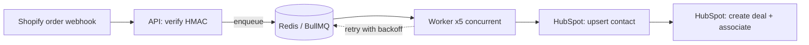

# Shopify → HubSpot Order Sync

A small, production-style integration that turns every new Shopify order into a **HubSpot contact + closed-won deal**, automatically.

Built to demonstrate the parts of integration work that usually break in the real world: webhook security, duplicate events, rate limits, and retries.

> This is an original demo project built with mock data and free developer accounts.

## The problem

Store owners often copy order and customer data into their CRM by hand, or use fragile no-code zaps that silently drop events. This service makes the sync reliable and observable.

## How it works



## Reliability features

- **Webhook signature verification** (HMAC-SHA256, timing-safe) so only Shopify can trigger syncs
- **Fast acknowledgement:** the API responds immediately and does the real work in a queue, so Shopify never times out
- **Deduplication:** Shopify's webhook id is used as the job id, so retried webhooks are ignored
- **Idempotent sync:** contacts are upserted by email and deals are checked before creation, so reprocessing never creates duplicates
- **Smart retries:** exponential backoff (2s, 4s, 8s...) for rate limits (429) and server errors (5xx); permanent errors (bad data, missing scopes) fail immediately instead of retrying forever
- **Concurrent workers** for throughput; failed jobs are retained for inspection
- **Validated config** with Zod; fails at startup if a secret is missing

## Tech stack

Node.js 20, TypeScript, Express, BullMQ, Redis, HubSpot CRM API v3, Docker

## Run it locally

1. **Accounts (all free):** a Shopify development store and a HubSpot developer/test account.
2. **HubSpot:** create a Private App with `crm.objects.contacts.read/write` and `crm.objects.deals.read/write` scopes, and copy the token.
3. **Configure:**
   ```bash
   cp .env.example .env   # fill in SHOPIFY_WEBHOOK_SECRET and HUBSPOT_ACCESS_TOKEN
   ```
4. **Start everything:**
   ```bash
   docker compose up --build
   ```
5. **Expose your API** (for example `ngrok http 3000`) and add a Shopify webhook for **Order creation** pointing to `https://<your-url>/webhooks/shopify/orders`.
6. Place a test order and watch the worker logs. The contact and deal appear in HubSpot.

Without Docker: run Redis locally, then `npm install`, `npm run dev:api` and `npm run dev:worker`.

## Project structure

```
src/
  server.ts    Webhook endpoint, signature check, enqueue
  queue.ts     BullMQ queue and retry policy
  worker.ts    Job processor (concurrency 5)
  hubspot.ts   HubSpot client, upsert logic, error classification
  shopify.ts   HMAC verification and order types
  config.ts    Validated environment config
```

## Ideas for extension

- Map line items to HubSpot products
- Handle refunds/cancellations by updating the deal stage
- Add a small dashboard for failed jobs (Bull Board)
- Two-way sync: push HubSpot contact updates back to Shopify

## Need something like this?

I build reliable integrations between Shopify, WooCommerce, HubSpot, Dynamics 365 and other business tools.
Reach me on [LinkedIn](https://www.linkedin.com/in/astha-p-shukla-b398b2213) or at astha.61097@gmail.com.
